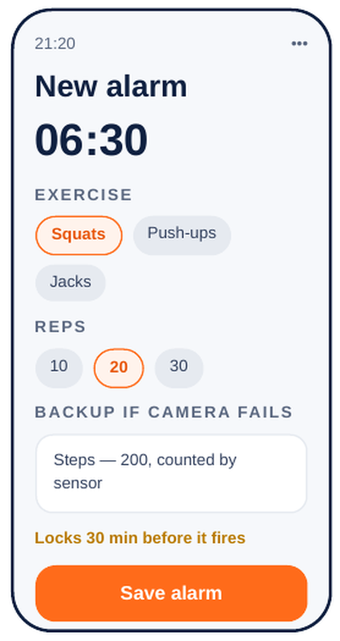

<p align="center">
  
</p>

<h1 align="center">Workout Alarm</h1>

<p align="center">
  <strong>The alarm you can't snooze.</strong><br>
  Set the time, pick a workout, go to sleep. When it rings, the only way to silence it
  is to do the reps — counted by the camera, on your phone, with no buttons to cheat with.
  <strong>No workout, no silence.</strong>
</p>

<p align="center">
  <a href="#what-it-does">What it does</a> ·
  <a href="#how-it-works">How it works</a> ·
  <a href="#development">Development</a> ·
  <a href="#coming-next">Coming next</a>
</p>

*Workout Alarm* is a strict Android alarm clock built with React Native + Expo. It exists for one
reason: mornings where willpower loses. This is a personal project.

|  |  |  |
|---|---|---|
| *Alarm list* | *New alarm* | *Ringing / workout* |

<p align="center"><sub>Design mockups — the visual target for v1. Real screenshots once the app ships.</sub></p>

## What it does

| | |
|---|---|
| **An alarm with a price of admission.** Set the time, choose squats, push-ups, jumping jacks or sit-ups, and set the rep target. When it rings, the screen locks down and the camera opens — the alarm stops only when the target is verified complete. | **Reps counted by the camera, not by you.** On-device ML Kit pose detection tracks your joints and counts only full-range reps at a human tempo. Half-reps and fast flailing don't count. Video frames never leave your phone. |
| **No dismiss. No snooze. No escape hatch.** The ringing screen has no buttons at all. Lock-task mode swallows Back, Home and recents while the alarm is active, and the foreground service keeps ringing through the lock screen. | **Survives everything short of willpower.** Exact alarms via `AlarmManager.setAlarmClock()`, re-armed automatically after reboots, dead batteries and clock changes. The workout debt never expires. |
| **Practice mode.** Check your camera framing and try the rep counter with zero stakes — no alarm, no lockdown, just you and the counter. | **Your data stays yours.** Alarms and history live in SQLite on the device, settings in MMKV. No account, no cloud, no analytics. |

## How it works

**The flow.** Set → Lock → Ring → Move → Verify → Release. At the scheduled time `AlarmModule`
fires an exact alarm and `RingingService` starts as a foreground service: alarm-stream audio loop,
volume re-assertion, vibration, and a full-screen intent over the lock screen. `LockdownModule`
enters lock-task mode; `PoseModule` opens the front camera and counts. `releaseAlarm()` — called
only after the rep target is verified — is the single code path that stops the sound, exits
lock-task, and records the session.

**Rep verification.** Each analyzed frame yields one joint angle for the active exercise (knee for
squats, elbow for push-ups, shoulder for jumping jacks, hip for sit-ups). A small state machine
in Kotlin — mirroring `src/workout/repCounter.ts` — counts a rep only when the angle travels the
full range and the cycle lands inside a human tempo window. Thresholds live in
`EXERCISE_COUNTER_CONFIGS`; the TypeScript copy exists for tests and the demo fallback.

**Native modules.** Five Kotlin bridges, applied by config plugins on every prebuild so `android/`
stays a pure build artifact:

1. **AlarmModule** — `AlarmManager.setAlarmClock()` exact scheduling; mirrors the schedule to SharedPreferences for the receivers.
2. **RingingModule + RingingService** — foreground service: alarm loop, volume re-assertion, vibration, full-screen intent. `releaseAlarm()` is the only exit.
3. **BootReceiver + TimeChangeReceiver** — re-arm after restarts, dead batteries, and clock changes.
4. **LockdownModule** — lock-task (kiosk) mode while ringing.
5. **PoseModule** — CameraX + ML Kit Pose Detection; only rep events cross the bridge, never video.

**Anti-bypass.** The ringing screen renders zero buttons; the release path is the only code that can
stop the service; the schedule is mirrored to disk so receivers re-arm it without the app running.

## Development

This project uses native modules, so it runs as an Expo **development build**, not in Expo Go.

```sh
npm install --legacy-peer-deps
npx expo prebuild              # generate android/ + apply config plugins
npx eas-cli build --platform android --profile development   # install the APK on your phone
npx expo start --dev-client    # then develop with live reload
npm test                       # vitest
npm run typecheck && npm run lint
```

- Stack: Expo SDK 57, React Native 0.81, TypeScript strict, Expo Router, expo-sqlite, react-native-mmkv, expo-camera.
- `android/` is generated and gitignored — native behavior lives in `app.json`, `plugins/` (config plugins) and `native-modules/` (canonical Kotlin sources).
- Tests cover the rep-counter state machine, the scheduling logic and the design tokens (`__tests__/`, vitest).
- Husky + lint-staged run ESLint, Prettier and `tsc --noEmit` on staged files.

**Demo mode.** Without the native bridges (Expo Go / web), the ringing screen runs a clearly-labelled
demo mode: synthetic joint angles through the real `RepCounter` state machine, so the full
set → ring → verify → release flow is exercisable end to end. Verified counting needs a dev build.

## Coming next

1. Emergency-exit valve design (clearly labelled, deliberately slow — never a snooze in disguise)
2. Voice rep counting as an alternative to the camera
3. Smart progression (rep targets that adapt) and workout stats
4. Release builds for the Play Store (internal track first)

## License

MIT — see [LICENSE](LICENSE).
