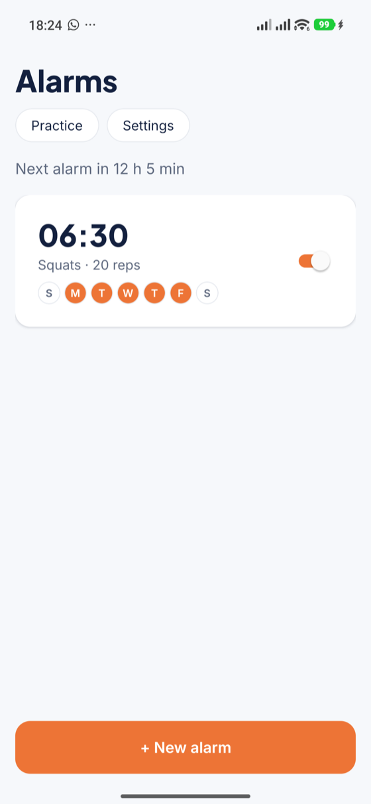
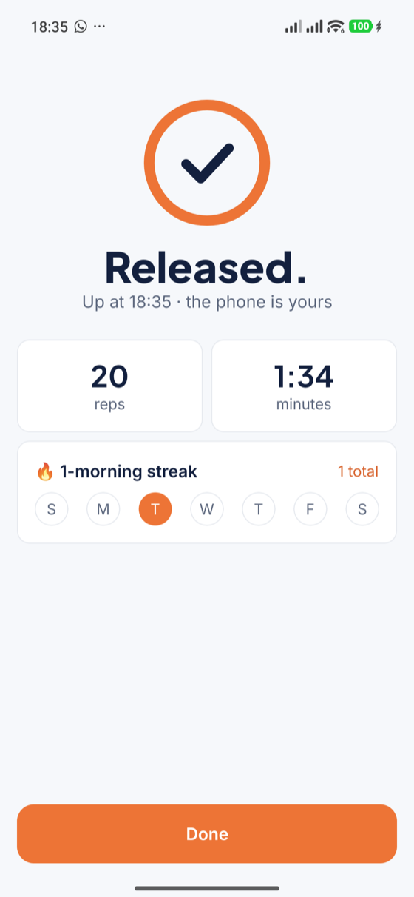
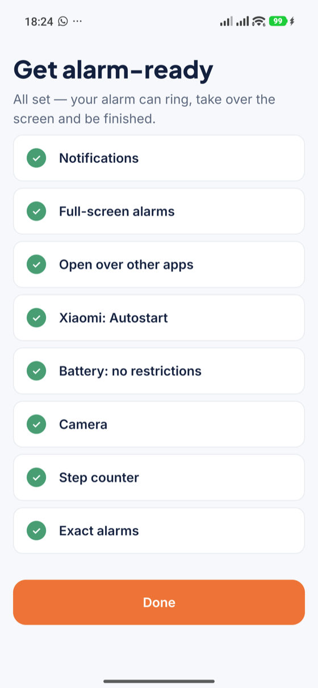
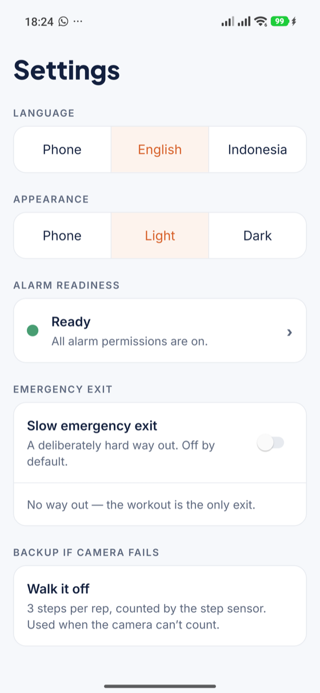
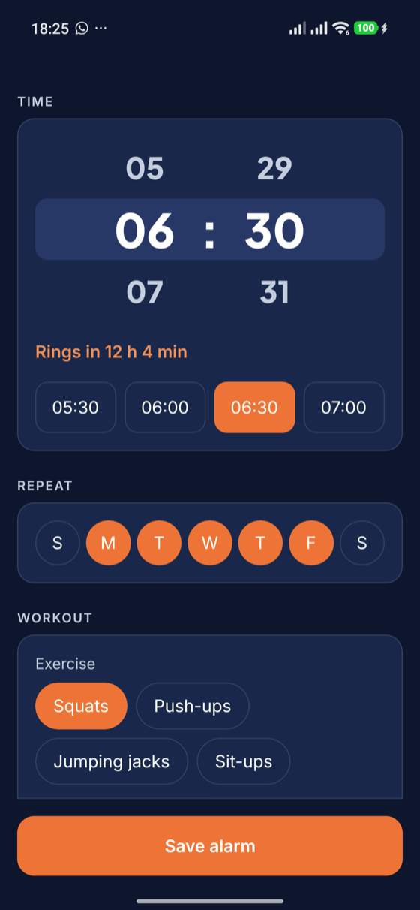
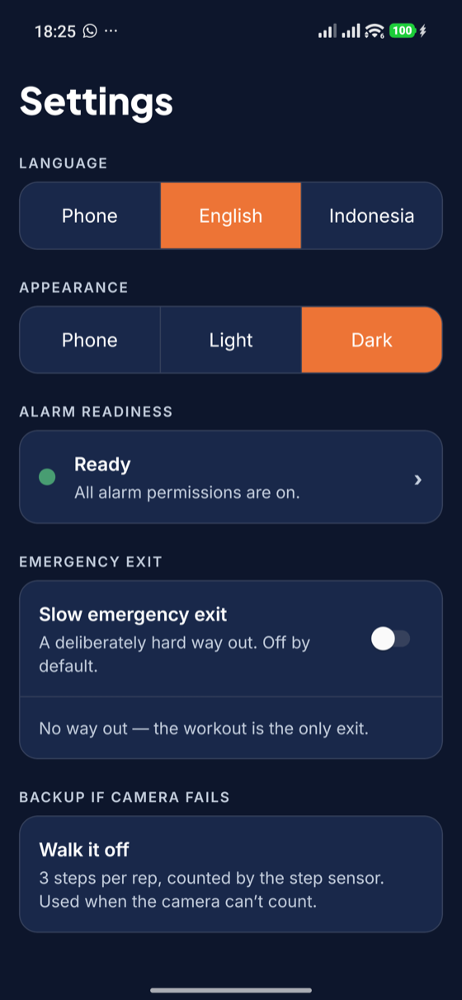

<p align="center">
  
</p>

<h1 align="center">Workout Alarm</h1>

<p align="center">
  <strong>The alarm you can't snooze.</strong><br>
  Set the time, pick a workout, go to sleep. When it rings, the only way to silence it
  is to do the reps — counted by the camera, on your phone, with no buttons to cheat with.
  <strong>No workout, no silence.</strong>
</p>

<p align="center">
  <a href="https://github.com/heyhadi/workout-alarm-app/releases/latest"><strong>Download the APK</strong></a> ·
  <a href="#what-it-does">What it does</a> ·
  <a href="#how-it-works">How it works</a> ·
  <a href="#development">Development</a>
</p>

*Workout Alarm* is a strict Android alarm clock built with React Native + Expo. It exists for one
reason: mornings where willpower loses. English and everyday Bahasa Indonesia, light and dark. This is a personal project.

<p align="center">
  
  
  
  
</p>
<p align="center">
  
  
  
</p>
<p align="center"><sub>The workout screen itself is a full-screen camera view with a framing border and the rep ring — best seen on your own phone.</sub></p>

## What it does

| | |
|---|---|
| **An alarm with a price of admission.** Set the time on an inline wheel, choose squats, push-ups, jumping jacks or sit-ups, and a rep target. When it rings, the workout takes over the screen — even if you're using another app — and the alarm stops only when the target is verified. | **Reps counted by the camera, not by you.** On-device ML Kit pose detection tracks your joints and counts only full-range reps at a human tempo. The camera fills the screen and a coloured border tells you from across the room whether you're in frame. Video never leaves your phone. |
| **No dismiss. No snooze. No escape hatch.** The ringing screen has no buttons at all. Lock-task mode swallows Back, Home and recents, and the foreground service keeps ringing through the lock screen. | **A backup that still makes you move.** Camera denied, broken, or nobody in frame for 2 minutes? The alarm switches to the step counter: 3 steps per rep. |
| **Survives everything short of willpower.** Every alarm is re-armed after reboots, dead batteries and clock changes; repeating alarms arm their next morning when you finish; a finished alarm never rings twice. | **Ready before it matters.** A readiness checklist walks through every permission the alarm needs — including Xiaomi's own switches — and the alarm list nags until they're all green. |
| **Practice mode.** The real workout screen and the real counter, with no alarm and no lockdown: try your framing and your squats before 6 a.m. does. | **Your sound, your language.** Pick any alarm sound on your phone (never silent). Use the app in English or Bahasa Indonesia. |
| **A finish worth waking for.** The rep ring closes with a check, then your reps and time, this week's mornings, your streak — and how much faster you were than last time. | **An emergency exit that isn't a snooze.** Off by default. When on, it appears only after 10 minutes of ringing: hold for 60 seconds, then type a sentence. That morning doesn't count toward your streak. |
| **Light and dark.** Follows your phone, or pick one in Settings. The workout screen is always dark. | **Updates itself.** Every build on `main` is published as a GitHub release; the app offers it in-app and installs it only if it's newer and signed with the same key. |
| **Your data stays yours.** Alarms and history live in SQLite on the device, settings in MMKV. No account, no cloud, no analytics. | |

## Install

1. Download the latest APK from [Releases](https://github.com/heyhadi/workout-alarm-app/releases/latest) and open it (allow installs from your browser when Android asks).
2. Open the app — the readiness checklist shows what to allow. On Xiaomi/HyperOS, also switch on Autostart there.
3. Later updates appear as **Update available** on the alarm list.

Android only. An iPhone version can't be truly unskippable — iOS always offers a Stop button — so it isn't planned yet.

## How it works

**The flow.** Set → Lock → Ring → Move → Verify → Release. At the scheduled time `AlarmModule`
fires an exact alarm and `RingingService` starts as a foreground service: alarm-stream audio loop
(your chosen sound, falling back to the phone default), volume re-assertion, vibration, a
full-screen intent over the lock screen, and a direct launch of the workout when the phone is in
use. `LockdownModule` enters lock-task mode; `PoseModule` opens the front camera and counts.
`releaseAlarm()` — called only after the target is verified — is the single code path that stops
the sound, exits lock-task, records the session and arms the next occurrence.

**Rep verification.** Each analyzed frame yields one value per exercise, measured on whichever
side of the body the camera sees best: hip drop for squats (works facing the camera), elbow angle
for push-ups, shoulder angle for jumping jacks, hip angle for sit-ups. A state machine counts a rep
only when the value travels the full range inside a human tempo window, and only while the joints
it needs are in frame. Thresholds live once, in `EXERCISE_COUNTER_CONFIGS`
(`src/workout/repCounter.ts`), and are passed to the native counter.

**Native modules.** Kotlin sources in `native-modules/`, applied by config plugins on every
prebuild so `android/` stays a pure build artifact:

1. **AlarmModule + AlarmStore** — `AlarmManager.setAlarmClock()` per alarm, mirrored to storage so receivers can re-arm without JS.
2. **RingingModule + RingingService** — the ringing foreground service, alarm-sound picker, and permission readiness checks.
3. **BootReceiver + TimeChangeReceiver** — re-arm every alarm after restarts and clock changes; resume one still owed.
4. **LockdownModule** — lock-task (kiosk) mode while ringing.
5. **PoseModule + PoseCameraView** — CameraX + ML Kit Pose Detection in one camera session; only rep and framing events cross the bridge, never video.
6. **StepModule** — hardware step counter for the camera backup.
7. **UpdateModule** — downloads a newer release APK, verifies package, version and signing key, and hands it to Android's installer.

**Anti-bypass.** The ringing screen renders zero buttons; the release path is the only code that can
stop the service; every armed alarm is mirrored to disk so receivers re-arm it without the app running.

## Development

This project uses native modules, so it runs as an Expo **development build**, not in Expo Go.

```sh
npm install --legacy-peer-deps
npx expo prebuild              # generate android/ + apply config plugins
npx expo run:android           # build and install a dev build on a USB-connected phone
npx expo start --dev-client    # then develop with live reload
npm test                       # vitest
npm run typecheck && npm run lint
```

- Stack: Expo SDK 57, React Native 0.86, TypeScript strict, Expo Router, expo-sqlite, react-native-mmkv, expo-camera.
- `android/` is generated and gitignored — native behavior lives in `app.json`, `plugins/` (config plugins) and `native-modules/` (canonical Kotlin sources).
- UI text lives in `src/i18n/` (`en.ts`, `id.ts`); the Indonesian file is typed against the English one, so a missing translation fails the build. Indonesian is written casually, the way people talk ("HP", "rep", "nggak").
- Colours come from semantic tokens (`theme/tokens.ts`) via `useTokens()` (`src/appearance.tsx`): light, dark, and the always-dark alarm set.
- Icon and splash sources are SVGs in `assets/source/`.
- Tests cover the rep counter, scheduling, readiness checklist, emergency exit rules, streak/progress, release parsing, languages and design tokens (`__tests__/`, vitest).
- CI (`.github/workflows/android-build.yml`) builds a signed release APK on every push to `main` and publishes it as release `build-<run number>`.

**Demo mode.** Without the native bridges (Expo Go / web), the workout screen runs a clearly-labelled
demo mode: synthetic joint angles through the real `RepCounter` state machine, so the full
set → ring → verify → release flow is exercisable end to end. Verified counting needs a dev build.

## Coming next

1. Voice rep counting as an alternative to the camera
2. Smart progression (rep targets that adapt) and workout stats
3. Release builds for the Play Store (internal track first)

## License

MIT — see [LICENSE](LICENSE).
